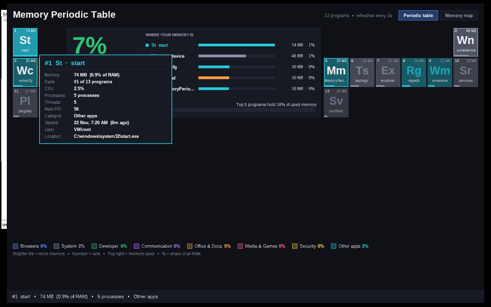
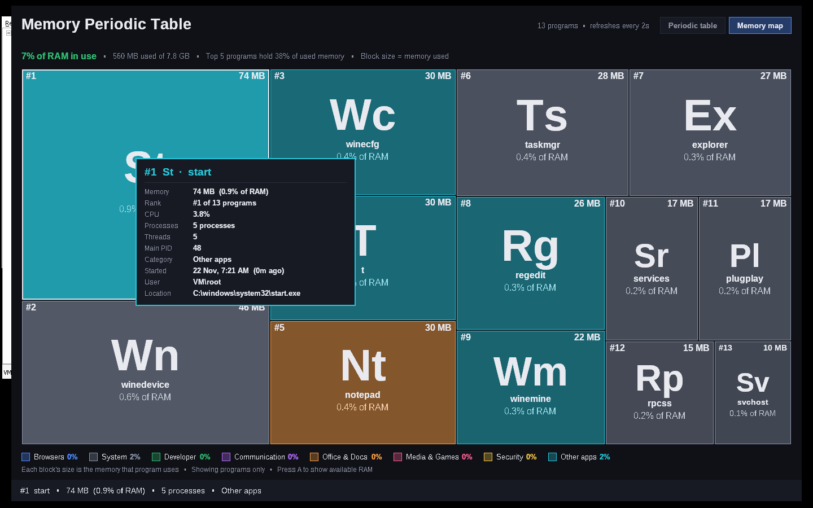

# Memory Periodic Table

A tiny Windows app (~100 KB, no install) that shows where your computer's RAM is going, laid out like a periodic table.

## Features
- **Periodic table view.** Every running program is an "element". Its number is its rank by memory use, its symbol is made from its name, and the top-right figure is the memory it uses. Tiles glow brighter the more memory they use.
- **"Where your memory is" panel.** Shows the top 5 programs with bars, their share of RAM, and how much of your used memory they hold together.
- **Memory map view.** A treemap where each block's size is the memory that program uses. Press **A** to show or hide the block for available RAM.
- **Hover details.** Hover over any tile to see memory, CPU, process and thread counts, PID, start time, user and file location.
- **Colour groups:** Browsers, System, Developer, Communication, Office, Media, Security and Other, each with its share of RAM.
- Updates every 2 seconds and adjusts for high-resolution (DPI-aware) screens.

## Download
Get `MemoryPeriodicTable.exe` from the **Releases** page and double-click it.
Because the app is not code-signed, Windows SmartScreen may warn you the first time. Click **More info**, then **Run anyway**.
Run it as administrator to see the details of protected system processes.

## Shortcuts
| Key | Action |
|-----|--------|
| `M` / `Tab` | Switch between Periodic table and Memory map |
| `A` | Show or hide available RAM in the Memory map |

## Build from source
Written in plain C using the Win32 API, with no dependencies.
- **On Windows (MSYS2/MinGW):** see the commands in `build.sh`.
- **On Linux:** install `gcc-mingw-w64-x86-64` and run `./build.sh`.

## Author
Jawad Ahmed Khan
